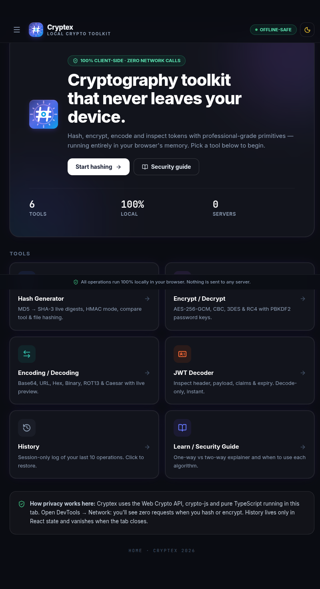

<div align="center">

# 🔐 Cryptex

### Local Cryptography Toolkit

A fully client-side toolkit for hashing, encryption, encoding and JWT inspection.
Every operation runs in your browser. No servers, no network calls, no data persistence.

[](https://xx80yx-q7ini6dni-arcadawebapps6.vercel.app/)


</div>

---

## 📸 Preview

<div align="center">
  
</div>

**🌐 Live demo:** [https://xx80yx-q7ini6dni-arcadawebapps6.vercel.app/](https://xx80yx-q7ini6dni-arcadawebapps6.vercel.app/)

---

## 📑 Table of Contents

- [About](#-about)
- [Features](#-features)
- [Tools](#-tools)
- [Supported Algorithms](#-supported-algorithms)
- [Tech Stack](#-tech-stack)
- [Privacy and Security Model](#-privacy-and-security-model)
- [Getting Started](#-getting-started)
- [Usage](#-usage)
- [Project Structure](#-project-structure)
- [FAQ](#-faq)
- [Contributing](#-contributing)
- [License](#-license)
- [Author](#-author)

---

## 📖 About

**Cryptex** is a single-page React application built for developers, security engineers and privacy-conscious users who need quick access to common cryptographic utilities without sending sensitive data to a third party.

All hashing, encryption, encoding and token inspection happens within the browser's memory. Cryptographic primitives come from the native **Web Crypto API**, **crypto-js** (for legacy algorithms) and custom TypeScript implementations.

---

## ✨ Features

| Feature | Description |
|---------|-------------|
| **100% client-side** | All processing happens in the browser. No network requests are made during hashing or encryption. |
| **Offline-safe** | Works without an internet connection after the initial load. |
| **Zero data persistence** | Input, output and history live only in React state and are erased when the tab closes. |
| **Modern and legacy primitives** | Uses the Web Crypto API where available, with crypto-js for legacy ciphers. |
| **Dark mode** | Light and dark themes with a built-in toggle. |
| **Responsive UI** | Collapsible sidebar on desktop and a hamburger menu on mobile. |

---

## 🧰 Tools

| Tool | Description |
|------|-------------|
| **Hash Generator** | Generate hashes and HMACs (MD5, SHA family, HMAC). |
| **Encrypt / Decrypt** | Symmetric encryption and decryption of text (AES, 3DES, RC4). |
| **Encoding** | Encode and decode data (Base64, Hex, Caesar cipher). |
| **JWT Decoder** | Decode and inspect JSON Web Token headers and claims. |
| **History** | Session-only log of operations. It is cleared when the tab is closed. |
| **Learn** | Built-in security guide covering core concepts and best practices. |

---

## 🔢 Supported Algorithms

| Category | Algorithms |
|----------|------------|
| **Hashing** | MD5, SHA-1, SHA-256, SHA-512, HMAC |
| **Encryption** | AES, 3DES, RC4 |
| **Encoding** | Base64, Hex, Caesar cipher |
| **Tokens** | JWT (header and payload decoding) |

> ⚠️ **Note:** MD5, SHA-1, 3DES, RC4 and the Caesar cipher are considered weak or obsolete. They are included for compatibility, learning and legacy use cases. Do not rely on them to protect sensitive data. Prefer AES and SHA-256 or stronger.

---

## 🛠️ Tech Stack

- **Framework:** React (single-page application)
- **Language:** TypeScript
- **Build tool:** Vite
- **Styling:** Tailwind CSS
- **Cryptography:** Web Crypto API, crypto-js, custom TypeScript modules
- **Deployment:** Vercel

---

## 🔒 Privacy and Security Model

- **No servers:** The app makes zero outbound requests during cryptographic operations.
- **No storage:** Keys and plaintext are not written to `localStorage`, `sessionStorage` or cookies by the toolkit.
- **Ephemeral state:** All input, output and history are destroyed on page unload.
- **Keys stay local:** Encryption keys never leave the browser tab.
- **Verifiable:** Open **DevTools → Network** and run any operation to confirm that no requests are sent.

---

## 🚀 Getting Started

### Prerequisites

- [Node.js](https://nodejs.org/) 18 or later
- npm (included with Node.js)

### Installation

```bash
# Clone the repository
git clone https://github.com/muhammadtalha3893/Cryptex.git

# Move into the project folder
cd Cryptex

# Install dependencies
npm install

# Start the development server
npm run dev
```

### Production build

```bash
npm run build
npm run preview
```

---

## 📘 Usage

1. Open the [live app](https://xx80yx-q7ini6dni-arcadawebapps6.vercel.app/) or run it locally.
2. Use the sidebar to pick a tool. The **Home** panel gives an overview and quick-start buttons.
3. Follow the steps for the tool you need:

**Hash text**
1. Open **Hash Generator** and enter or paste your text.
2. Select an algorithm (MD5, SHA-1, SHA-256, etc.).
3. Copy the hash from the output field.

**Encrypt data**
1. Open **Encrypt / Decrypt** and choose a cipher (AES, 3DES or RC4).
2. Enter a secret key and your plaintext, then click **Encrypt**.
3. Copy the ciphertext from the output area.

**Decode a JWT**
1. Open **JWT Decoder** and paste your token.
2. The header and claims appear in a structured view.

**Review history**
- Open **History** to see this session's operations. Closing the tab permanently clears the log.

---

## 📂 Project Structure

```
Cryptex/
├── screenshot/
│   └── sc1.png
├── public/
├── src/
│   ├── components/
│   ├── utils/
│   ├── App.tsx
│   └── main.tsx
├── index.html
├── package.json
├── tsconfig.json
├── vite.config.ts
└── README.md
```

---

## ❓ FAQ

**Is my data sent to a server?**
No. All operations run locally in your browser. You can verify this in the DevTools Network tab.

**Does Cryptex store my keys or plaintext?**
No. They exist only in browser memory (React state) and are never written to disk or remote storage.

**Can I use it offline?**
Yes. After the first page load, the toolkit works without an internet connection.

**Is history saved between sessions?**
No. History is session-only and is cleared when the tab closes.

---

## 🤝 Contributing

Contributions, issues and feature requests are welcome.

1. Fork the repository
2. Create a feature branch: `git checkout -b feature/your-feature`
3. Commit your changes: `git commit -m "Add your feature"`
4. Push to the branch: `git push origin feature/your-feature`
5. Open a Pull Request

---

## 📄 License

Distributed under the MIT License. See [`LICENSE`](LICENSE) for details.

---

## 👤 Author

**Muhammad Talha**
GitHub: [@muhammadtalha3893](https://github.com/muhammadtalha3893)

---

<div align="center">

⭐ If you find Cryptex useful, consider giving it a star.

</div>
